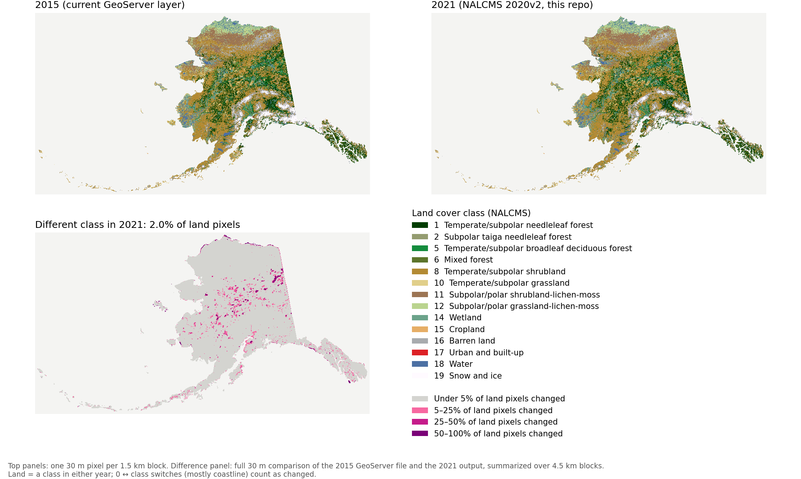

# landcover_2021

Drop-in replacement for the GeoServer layer `alaska_wildfires:alaska_landcover_2015`, built from the
CEC **NALCMS 2020 v2** 30 m land cover. The Alaska part of that release uses 2021 imagery (CONUS is 2019, Canada and Mexico
are 2020), so the result is named `land_cover_2021_albers.tif`. Only the data changes. The grid, CRS, data type, encoding,
nodata convention and color table all match the 2015 file behind the layer, so the layer's store can point at the new file
with no style or layer changes.

Data lives outside the repo, in `/import/beegfs/CMIP6/jdpaul3/landcover_2021_data/{raw,work,output,logs}`.

## Inputs

- **2021 source:** `https://www.cec.org/files/atlas_layers/1_terrestrial_ecosystems/1_01_0_land_cover_2020_30m/usa_land_cover_2020v2_30m_tif.zip`
  (1,688,931,815 bytes, sha256 `f8308b40a2b0ced8fda2759f5b4066c4e8d80bf23dcf90b99da16e8557fa1508`), downloaded 2026-10-30, plus
  `metadata.zip` from the same directory (sha256 `6f10971d076d4661bcc4ded89a3026907ae0345fb8bd652c09152fc519186a40`).
  - File used: `ASK_NALCMS_landcover_2020v2_30m.tif`, the Alaska tile, which is separate from CONUS.
  - Its CRS is LAEA (WGS84, lat 45 / lon -100), and it is 30 m Byte.
  - Its nodata tag is 127, but no pixels actually hold 127. Ocean, Canada and Russia inside the tile are 0.
  - The class codes use the standard NALCMS 19-class legend, the same as 2015.
- **2015 reference:** the actual file behind the GeoServer layer, `/beegfs/CMIP6/crstephenson/misc/land_cover_2015_albers.tif`.
  It is copied read-only to `raw/geoserver_2015/` (sha256 `8702bebc01a6ef05b2a66e5ed16416015ebe2bfdd6977dbccb51740ab044f949`).
  This file is the target spec. The GeoServer WCS is used only as a cross-check.

## Target: the 2015 file

| | |
|---|---|
| CRS | **EPSG:6393** NAD83(2011) / Alaska Albers. GeoServer advertises the layer as EPSG:3338, which has the same projection parameters. |
| Grid | 144162 × 126857 px at 30 m; extent `-2542313.2452769727 -836092.2311327262 1782546.7547230273 2969617.768867274` (not integer-aligned) |
| Type | **Int8** (signed), paletted (`scripts/colortable_2015.csv`) |
| Values | 1–19 classes; **0** = no data inside the source tile (ocean/Canada); **-128** = nodata outside the source tile (GeoServer serves it as 128) |
| Layout | BigTIFF, LZW, 128 × 128 tiles, no overviews (written by ArcGIS) |

## Processing (`scripts/`)

1. `download.sh`: downloads with curl, checks byte counts, writes sha256 and unzips.
2. `warp.slurm` (Slurm, t1small): runs `gdalwarp` to EPSG:6393 on the exact 2015 grid (`-te` as above, `-tr 30 30`, no `-tap`),
   with nearest neighbour and exact transforms (`-et 0`), and `-srcnodata 127 -dstnodata 128`.
   - Source 0 stays 0, and everything outside the source tile becomes 128, which becomes -128 in step 3.
   - PROJ applies no datum shift between WGS84 and NAD83(2011), so 6393 and 3338 give identical pixels.
   - The job then runs steps 3 and 4.
3. `finalize.sh`:
   1. Writes the 2015 color table (`set_colortable.py`).
   2. Sets the nodata tag to -128 (`gdal_edit.py`).
   3. Runs `gdal_translate -co PIXELTYPE=SIGNEDBYTE` (LZW, 128 tiles, BigTIFF), which turns 128 into -128.

   GDAL refuses a color table on an Int8 band, and the deprecated `PIXELTYPE=SIGNEDBYTE` copy is the only way it writes a
   palette on signed 8-bit data.
4. `verify.py`: compares the output with the 2015 file (structure plus a full-resolution pixel comparison), then cross-checks against the WCS.
   It writes `output/land_cover_2021_albers_verify.txt`.
5. `compare_map.py`: draws the map below at full resolution from the two files.

Environment: the conda env `snap-geo` on Chinook (GDAL 3.7.0). The scripts activate it, and `PROJ_DATA` is only set once it is active.

## Verification

Run 2026-10-30, Slurm job 738214 (about 11 min). Every check passed. Full report: `output/land_cover_2021_albers_verify.txt`.

- **Structure is identical to the 2015 file:** CRS (EPSG:6393), size, geotransform (exact), Int8, palette, color table, nodata -128,
  LZW, 128 × 128 tiles, BigTIFF and no overviews.
- **Values:** only -128, 0 and 1–19 are present.
- **Registration:** the best ±1 px shift is (0, 0) in all 145 land windows (4096 × 4096 px), so the pixels line up exactly with 2015.
- **Outside footprint (-128):** matches 2015 except for 9,757 of 9.07 billion pixels, which is single-pixel jitter along the source-tile edge.
- **Class pixels:** 98.06% of pixels that are a class in both years have the same class.
  0.99 M pixels go from class to 0 and 0.57 M from 0 to class, mostly along the coastline.
  Class shares changed by less than 0.4 percentage points.
- **WCS:** 23 full-resolution strips from GeoServer are identical to the 2015 file, so GeoServer serves that file unchanged (apart from
  reporting EPSG:3338 and -128 as 128). Point checks and the AK/Yukon border transect also agree.

### 2015 vs 2021

**2.0% of land pixels have a different class in 2021**, compared at full 30 m resolution. Most 4.5 km blocks have a few
scattered changed pixels, so blocks with under 5% change are shown gray. The colored patches are where change is concentrated.

## Notes

- rasterio and GDAL both read the output as int8 with nodata -128. GeoServer reads the same bytes as unsigned 128, exactly as it
  does for the 2015 file.
- The grid crosses the antimeridian (the western Aleutians). The data are only warped from one projected CRS to another and never pass through EPSG:4326.
- Out of scope: the GeoServer swap itself, and updating the layer's title or abstract to say the data are 2021 (NALCMS 2020v2).
